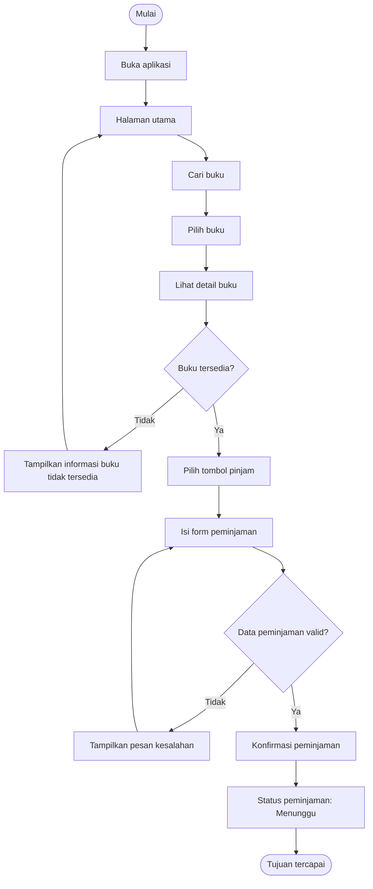

# Dokumen Kebutuhan Aplikasi Perpustakaan Kampus

## 1. Deskripsi Aplikasi
Aplikasi Perpustakaan Kampus merupakan aplikasi mobile yang dirancang untuk membantu mahasiswa dalam mencari informasi buku, melihat ketersediaan buku, serta melakukan proses peminjaman buku melalui perangkat mobile. Aplikasi ini diharapkan dapat mempermudah mahasiswa dalam memperoleh informasi perpustakaan tanpa harus datang langsung ke perpustakaan hanya untuk mencari buku atau mengetahui status peminjaman.
Aplikasi ini melibatkan dua jenis pengguna, yaitu mahasiswa sebagai pengguna utama yang mencari dan meminjam buku, serta petugas perpustakaan yang mengelola data buku dan memproses pengajuan peminjaman.

## 2. User Persona
### 2.1 Persona 1 — Mahasiswa
| Komponen              | Deskripsi                                                                                   |
| --------------------- | ------------------------------------------------------------------------------------------- |
| Nama dan peran        | Rani — Mahasiswa                                                                            |
| Tujuan                | Mencari buku yang dibutuhkan, mengetahui ketersediaan buku, dan melakukan peminjaman buku   |
| Kendala               | Jadwal kuliah cukup padat sehingga waktu untuk datang langsung ke perpustakaan terbatas     |
| Perangkat dan konteks | Smartphone, digunakan ketika berada di kampus maupun di luar kampus                         |
| Frekuensi penggunaan  | Beberapa kali dalam seminggu ketika membutuhkan buku atau ingin memeriksa status peminjaman |

### 2.2 Persona 2 — Petugas Perpustakaan
| Komponen              | Deskripsi                                                                                                           |
| --------------------- | ------------------------------------------------------------------------------------------------------------------- |
| Nama dan peran        | Dedi — Petugas Perpustakaan                                                                                         |
| Tujuan                | Mengelola data buku dan memproses pengajuan peminjaman buku                                                         |
| Kendala               | Harus melayani beberapa mahasiswa sehingga pengelolaan data dan pengajuan peminjaman perlu dilakukan secara teratur |
| Perangkat dan konteks | Smartphone atau komputer yang digunakan saat bertugas di perpustakaan                                               |
| Frekuensi penggunaan  | Setiap hari selama jam operasional perpustakaan                                                                     |

## 3. Kebutuhan Fungsional
Kebutuhan fungsional menjelaskan fungsi yang harus dapat dilakukan oleh aplikasi berdasarkan kebutuhan pengguna.
| ID   | Kebutuhan Fungsional                                            | Aktor     | Aksi                      | Hasil yang Dapat Diverifikasi                     |
| ---- | --------------------------------------------------------------- | --------- | ------------------------- | ------------------------------------------------- |
| F-01 | Mahasiswa dapat melihat daftar buku yang tersedia pada aplikasi | Mahasiswa | Melihat daftar buku       | Daftar buku ditampilkan pada halaman utama        |
| F-02 | Mahasiswa dapat mencari buku berdasarkan judul atau kategori    | Mahasiswa | Mencari buku              | Buku yang sesuai dengan kata kunci ditampilkan    |
| F-03 | Mahasiswa dapat melihat detail buku yang dipilih                | Mahasiswa | Melihat detail buku       | Informasi buku dan ketersediaannya ditampilkan    |
| F-04 | Mahasiswa dapat mengajukan peminjaman buku yang tersedia        | Mahasiswa | Mengajukan peminjaman     | Data pengajuan peminjaman tersimpan               |
| F-05 | Mahasiswa dapat melihat status peminjaman buku                  | Mahasiswa | Melihat status peminjaman | Status peminjaman ditampilkan                     |
| F-06 | Petugas dapat mengelola data buku perpustakaan                  | Petugas   | Mengelola data buku       | Data buku dapat ditambahkan, diubah, atau dihapus |
| F-07 | Petugas dapat memproses pengajuan peminjaman mahasiswa          | Petugas   | Memproses pengajuan       | Status pengajuan berubah sesuai tindakan petugas  |

## 4. Kebutuhan Nonfungsional
Kebutuhan nonfungsional menjelaskan kualitas dan batasan yang harus dipenuhi oleh aplikasi.

| ID    | Kategori | Kebutuhan Nonfungsional                                                           | Kriteria Terukur                                                                 |
| ----- | -------- | --------------------------------------------------------------------------------- | -------------------------------------------------------------------------------- |
| NF-01 | Kegunaan | Proses peminjaman harus memiliki alur yang sederhana                              | Pengguna dapat menyelesaikan pengajuan peminjaman maksimal dalam 5 langkah utama |
| NF-02 | Kinerja  | Daftar buku dapat ditampilkan dengan waktu respons yang dapat diterima            | Daftar buku ditampilkan maksimal 3 detik pada kondisi jaringan normal            |
| NF-03 | Keamanan | Data peminjaman pribadi hanya dapat diakses oleh pengguna yang memiliki hak akses | Pengguna harus melakukan autentikasi sebelum mengakses data peminjaman pribadi   |

## 5. Prioritas Fitur dengan MoSCoW
Prioritas fitur ditentukan menggunakan metode MoSCoW untuk menentukan fitur yang menjadi kebutuhan utama dan fitur yang dapat dikembangkan setelah kebutuhan utama terpenuhi.
| ID   | Fitur                          | Prioritas   | Alasan                                                      |
| ---- | ------------------------------ | ----------- | ----------------------------------------------------------- |
| F-01 | Melihat daftar buku            | Must have   | Merupakan fungsi utama untuk mengetahui koleksi buku        |
| F-02 | Mencari buku                   | Must have   | Membantu mahasiswa menemukan buku dengan lebih cepat        |
| F-03 | Melihat detail buku            | Must have   | Mahasiswa membutuhkan informasi buku sebelum meminjam       |
| F-04 | Mengajukan peminjaman          | Must have   | Merupakan tujuan utama mahasiswa menggunakan aplikasi       |
| F-05 | Melihat status peminjaman      | Must have   | Mahasiswa perlu mengetahui status pengajuan peminjaman      |
| F-06 | Mengelola data buku            | Should have | Dibutuhkan petugas untuk menjaga data buku tetap diperbarui |
| F-07 | Memproses pengajuan peminjaman | Should have | Dibutuhkan petugas untuk mengelola pengajuan mahasiswa      |

## 6. User Flow
User flow berikut menggambarkan alur utama mahasiswa dalam mencari dan mengajukan peminjaman buku.

### 6.1 Diagram User Flow

### 6.2 Penjelasan User Flow
Alur dimulai ketika mahasiswa membuka aplikasi dan masuk ke halaman utama. Mahasiswa kemudian mencari buku berdasarkan judul atau kategori dan memilih buku yang diinginkan. Setelah melihat detail buku, sistem akan memeriksa ketersediaan buku.
Jika buku tidak tersedia, aplikasi menampilkan informasi bahwa buku tidak dapat dipinjam dan mahasiswa kembali ke halaman utama untuk mencari buku lain. Jika buku tersedia, mahasiswa dapat memilih tombol pinjam dan mengisi formulir peminjaman.
Setelah formulir diisi, sistem memeriksa validitas data peminjaman. Jika data tidak valid, aplikasi menampilkan pesan kesalahan dan mahasiswa kembali ke formulir untuk memperbaiki data. Jika data valid, mahasiswa melakukan konfirmasi peminjaman dan sistem menyimpan pengajuan dengan status "Menunggu".

## 7. Pemetaan Kebutuhan ke Antarmuka
Pemetaan kebutuhan dilakukan untuk menghubungkan setiap kebutuhan fungsional dengan halaman aplikasi dan widget yang direncanakan.
| ID Kebutuhan | Rumusan Singkat                | Prioritas   | Halaman yang Memenuhi        | Widget yang Direncanakan                          |
| ------------ | ------------------------------ | ----------- | ---------------------------- | ------------------------------------------------- |
| F-01         | Melihat daftar buku            | Must have   | Halaman Beranda              | Scaffold, ListView.builder, ListTile              |
| F-02         | Mencari buku                   | Must have   | Halaman Beranda              | TextField, ListView.builder                       |
| F-03         | Melihat detail buku            | Must have   | Halaman Detail Buku          | Scaffold, Column, Text                            |
| F-04         | Mengajukan peminjaman          | Must have   | Halaman Form Peminjaman      | Scaffold, Column, TextField, ElevatedButton       |
| F-05         | Melihat status peminjaman      | Must have   | Halaman Status Peminjaman    | ListView.builder, ListTile, Text                  |
| F-06         | Mengelola data buku            | Should have | Halaman Kelola Buku          | ListView.builder, FloatingActionButton, TextField |
| F-07         | Memproses pengajuan peminjaman | Should have | Halaman Pengajuan Peminjaman | ListView.builder, ListTile, ElevatedButton        |

## 8. Deklarasi Penggunaan AI
ChatGPT digunakan sebagai asisten pembelajaran untuk membantu memahami panduan Tugas 4, memeriksa rumusan kebutuhan fungsional dan nonfungsional, serta memberikan masukan terhadap user flow. Hasil akhir disesuaikan dan dirumuskan kembali oleh penulis berdasarkan domain aplikasi Perpustakaan Kampus.

## 9. Refleksi
Bagian yang paling sulit dalam analisis adalah menentukan prioritas fitur karena tidak semua fitur dapat dianggap sebagai kebutuhan utama aplikasi. Penentuan user flow juga membutuhkan perhatian agar setiap keputusan memiliki kondisi berhasil dan gagal serta tetap sesuai dengan tujuan utama pengguna. Dari proses ini saya memahami bahwa kebutuhan pengguna harus ditentukan terlebih dahulu sebelum merancang tampilan dan mengimplementasikan aplikasi.