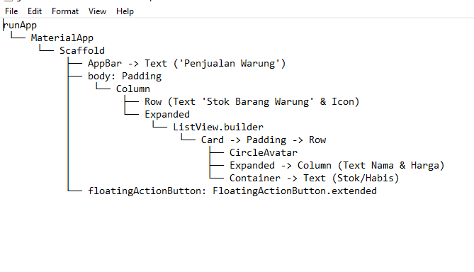

# Tugas 3 — Halaman Aplikasi Sederhana (Penjualan Warung)

**Nama:** Amelia Oktaviani  
**NIM:** 230660221127  
**Domain SI:** Usaha Mikro — Warung (Aplikasi Mobile Pengelolaan Penjualan Warung)

## Deskripsi Halaman

Halaman ini merupakan antarmuka pemantauan stok dan daftar barang pada Aplikasi Penjualan Warung. Halaman menampilkan daftar produk warung seperti sembako, makanan, dan minuman lengkap dengan harga, kategori, serta status ketersediaan stok yang diberi indikator warna berbasis ekspresi ternary.

## Widget Tree

## Refleksi

Widget layout yang paling sulit dirangkai adalah menyusun `ListView.builder` di dalam komponen `Column`. Hal ini disebabkan timbulnya kendala `RenderFlex overflow` karena ukuran area `ListView` yang tidak terbatas secara vertikal. Masalah tersebut berhasil diselesaikan dengan membungkus `ListView.builder` menggunakan widget `Expanded`.
