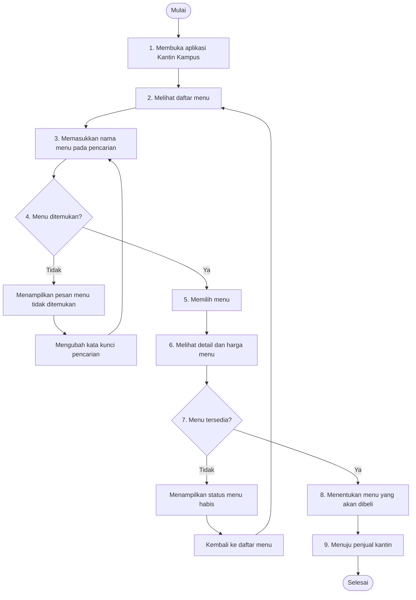

# Dokumen Kebutuhan Aplikasi Kantin Kampus

## 1. Deskripsi Aplikasi

**Kantin Kampus** adalah aplikasi sederhana yang dirancang untuk membantu mahasiswa melihat informasi menu makanan dan minuman yang tersedia di kantin kampus. Melalui aplikasi ini, mahasiswa dapat melihat daftar menu, mencari menu berdasarkan nama, melihat harga, dan mengetahui ketersediaan menu. Aplikasi ini juga mendukung penjual dalam mengelola informasi menu agar informasi yang ditampilkan kepada mahasiswa lebih mudah diperbarui.

Tujuan pengembangan aplikasi adalah mempermudah mahasiswa memperoleh informasi menu kantin sebelum membeli makanan atau minuman.

## 2. User Persona

### Persona 1 — Mahasiswa

- **Nama:** Raka
- **Peran:** Mahasiswa dan calon pembeli.
- **Tujuan:** Menemukan makanan atau minuman yang sesuai dengan keinginan dan anggaran.
- **Kebutuhan:** Daftar menu, informasi harga, fitur pencarian, dan informasi ketersediaan menu.
- **Kendala:** Tidak mengetahui menu yang dijual dan khawatir menu yang diinginkan sudah habis.

### Persona 2 — Penjual Kantin

- **Nama:** Bu Siti
- **Peran:** Penjual makanan dan minuman di kantin kampus.
- **Tujuan:** Menyampaikan informasi menu dan harga kepada mahasiswa.
- **Kebutuhan:** Fitur untuk menambahkan menu serta memperbarui informasi menu dan ketersediaannya.
- **Kendala:** Informasi menu dapat berubah, sehingga perlu cara yang praktis untuk memperbaruinya.

## 3. Kebutuhan Fungsional

Kebutuhan fungsional berikut ditulis berdasarkan aktor, tindakan, dan hasil yang diharapkan.

| ID | Aktor | Kebutuhan Fungsional | Hasil yang Diharapkan |
|---|---|---|---|
| F-01 | Mahasiswa | Melihat daftar menu makanan dan minuman. | Sistem menampilkan daftar menu beserta nama dan harga. |
| F-02 | Mahasiswa | Memilih menu untuk melihat detailnya. | Sistem menampilkan informasi detail menu dan harga. |
| F-03 | Mahasiswa | Mencari menu berdasarkan nama. | Sistem menampilkan menu yang sesuai dengan kata kunci pencarian. |
| F-04 | Mahasiswa | Memeriksa ketersediaan menu. | Sistem menampilkan status menu tersedia atau habis. |
| F-05 | Penjual | Menambahkan menu baru dengan mengisi informasi menu. | Sistem menampilkan menu baru dalam daftar menu setelah berhasil ditambahkan. |
| F-06 | Penjual | Memperbarui informasi menu, seperti nama, harga, atau ketersediaan. | Sistem menampilkan informasi menu yang telah diperbarui. |

## 4. Kebutuhan Nonfungsional

| ID | Kebutuhan Nonfungsional | Indikator Keberhasilan |
|---|---|---|
| NF-01 | Kinerja tampilan daftar menu. | Daftar menu tampil dalam waktu maksimal 3 detik pada minimal 90% dari 20 percobaan pengujian dengan kondisi perangkat dan data yang sama. |
| NF-02 | Kemudahan penggunaan. | Minimal 4 dari 5 responden uji dapat membuka detail menu dari daftar menu dalam maksimal 3 interaksi tanpa bantuan. |

Target di atas merupakan kriteria pengujian yang direncanakan, bukan hasil pengujian yang sudah dilakukan.

## 5. Prioritas Fitur (MoSCoW)

MoSCoW digunakan untuk menentukan tingkat prioritas pengembangan fitur berdasarkan kebutuhan pengguna.

| ID | Fitur | Prioritas | Alasan |
|---|---|---|---|
| F-01 | Melihat daftar menu | **Must Have** | Merupakan fungsi utama agar mahasiswa dapat mengetahui pilihan menu kantin. |
| F-02 | Melihat detail dan harga menu | **Must Have** | Membantu mahasiswa mengetahui informasi menu sebelum memilih. |
| F-04 | Memeriksa ketersediaan menu | **Must Have** | Mengurangi kemungkinan mahasiswa memilih menu yang sudah habis. |
| F-03 | Mencari menu berdasarkan nama | **Should Have** | Mempercepat pencarian menu, tetapi daftar menu masih dapat dilihat tanpa fitur ini. |
| F-06 | Memperbarui informasi menu | **Should Have** | Membantu menjaga informasi menu tetap sesuai dengan perubahan yang terjadi. |
| F-05 | Menambahkan menu baru | **Could Have** | Berguna untuk pengembangan pengelolaan menu, tetapi dapat ditunda pada versi awal apabila data menu masih disiapkan secara terbatas. |

**Won't Have untuk versi awal:** pembayaran online dan pemesanan makanan langsung melalui aplikasi belum termasuk ruang lingkup pengembangan. Fitur tersebut dapat dipertimbangkan pada versi berikutnya setelah fungsi informasi menu berjalan dengan baik.

## 6. Pemetaan Kebutuhan ke Antarmuka

Tabel berikut memetakan setiap kebutuhan fungsional ke halaman dan widget yang direncanakan pada aplikasi Kantin Kampus. Nama halaman dan widget perlu disesuaikan dengan implementasi aktual pada Tugas 3.

| ID | Halaman | Widget/Komponen Antarmuka | Fungsi |
|---|---|---|---|
| F-01 | Halaman Daftar Menu | `Scaffold`, `AppBar`, `ListView` atau `GridView`, `Card`, `Text` | Menampilkan daftar menu beserta nama dan harga. |
| F-02 | Halaman Detail Menu | `Scaffold`, `AppBar`, `Column`, `Text`, `Image` jika tersedia | Menampilkan informasi menu yang dipilih. |
| F-03 | Halaman Daftar Menu | `TextField`, `IconButton`, `ListView` atau `GridView` | Memungkinkan mahasiswa mencari menu berdasarkan nama. |
| F-04 | Halaman Daftar Menu atau Detail Menu | `Text`, `Chip` atau `Container` | Menampilkan status ketersediaan menu. |
| F-05 | Halaman Tambah Menu | `TextField`, `ElevatedButton`, `Form` | Memungkinkan penjual mengisi informasi menu baru. |
| F-06 | Halaman Edit Menu | `TextField`, `DropdownButton` atau komponen pilihan status, `ElevatedButton`, `Form` | Memungkinkan penjual memperbarui informasi menu. |

## 7. User Flow

### 7.1 Identitas Alur

| **Aspek** | **Isi** |
|---|---|
| Nama alur | Mencari dan memilih menu makanan |
| Aktor | Mahasiswa sebagai calon pembeli |
| Tujuan alur | Mahasiswa dapat menemukan menu, melihat detail dan harga, memeriksa ketersediaan, serta menentukan menu yang akan dibeli. |

### 7.2 Diagram User Flow

Diagram berikut menggambarkan alur mahasiswa dalam mencari dan memilih menu pada aplikasi Kantin Kampus.

### 7.3 Daftar Langkah

| **No.** | **Jenis** | **Langkah/Halaman** | **Bila gagal** |
|---|---|---|---|
| 1 | Mulai | Mahasiswa membuka aplikasi Kantin Kampus. | — |
| 2 | Halaman | Sistem menampilkan halaman daftar menu. | Mahasiswa mencoba membuka halaman kembali jika gagal dimuat. |
| 3 | Halaman | Mahasiswa memasukkan nama menu pada kolom pencarian. | Mahasiswa dapat mengubah kata kunci pencarian. |
| 4 | Keputusan | Apakah menu ditemukan? | Jika tidak, sistem menampilkan pesan dan mahasiswa mengubah kata kunci. |
| 5 | Halaman | Mahasiswa memilih menu dari hasil pencarian. | Mahasiswa dapat kembali ke daftar menu untuk memilih menu lain. |
| 6 | Halaman | Sistem menampilkan detail dan harga menu. | Mahasiswa kembali ke daftar menu jika detail tidak dapat ditampilkan. |
| 7 | Keputusan | Apakah menu tersedia? | Jika tidak, sistem menampilkan status habis dan mahasiswa kembali ke daftar menu. |
| 8 | Proses | Mahasiswa menentukan menu yang akan dibeli. | Jika menu tidak lagi tersedia, mahasiswa memilih menu lain. |
| 9 | Proses | Mahasiswa menuju penjual kantin untuk membeli menu. | Mahasiswa dapat memilih menu lain jika pembelian tidak dapat dilanjutkan. |
| 10 | Tujuan | Mahasiswa selesai memilih menu yang akan dibeli. | — |

