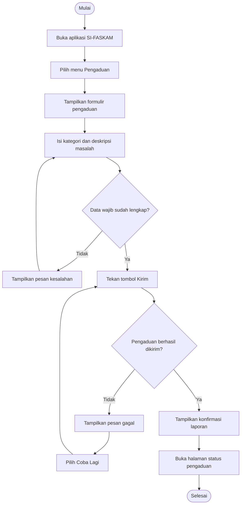

# User Flow — SI-FASKAM

## 1. Identitas Alur

| Aspek | Isi |
|---|---|
| Nama alur | Mengirim pengaduan fasilitas kampus |
| Aktor | Mahasiswa (Persona 1) |
| Tujuan alur | Mahasiswa berhasil mengirim pengaduan dan melihat konfirmasi bahwa laporan telah diterima. |

## 2. Diagram User Flow

## 3. Daftar Langkah

| No. | Jenis | Langkah/Halaman | Bila gagal |
|---:|---|---|---|
| 1 | Mulai | Mahasiswa memulai proses pengaduan. | — |
| 2 | Halaman | Mahasiswa membuka aplikasi SI-FASKAM. | — |
| 3 | Halaman | Mahasiswa memilih menu Pengaduan. | — |
| 4 | Halaman | Aplikasi menampilkan formulir pengaduan. | Kembali ke beranda jika formulir tidak dapat dibuka. |
| 5 | Input | Mahasiswa memilih kategori fasilitas dan mengisi deskripsi masalah. | Memperbaiki isian yang belum lengkap. |
| 6 | Keputusan | Apakah semua data wajib sudah lengkap? | Jika tidak, aplikasi menampilkan pesan kesalahan dan mahasiswa kembali melengkapi formulir. |
| 7 | Proses | Mahasiswa menekan tombol Kirim. | — |
| 8 | Keputusan | Apakah pengaduan berhasil dikirim? | Jika tidak, aplikasi menampilkan pesan gagal dan mahasiswa dapat mencoba kembali. |
| 9 | Halaman | Aplikasi menampilkan konfirmasi laporan berhasil dikirim. | — |
| 10 | Halaman | Mahasiswa membuka halaman status pengaduan. | Memeriksa kembali laporan jika status belum tampil. |
| 11 | Selesai | Mahasiswa selesai mengirim pengaduan dan melihat statusnya. | — |

## 4. Daftar Pemeriksaan Diagram

- Jumlah langkah: 9 langkah proses/halaman/input, di luar titik mulai dan tujuan.
- Jumlah titik keputusan: 2.
- Keputusan kelengkapan data memiliki cabang Ya dan Tidak.
- Keputusan keberhasilan pengiriman memiliki cabang Ya dan Tidak.
- Cabang gagal memiliki tindakan lanjutan sehingga tidak berhenti tanpa arah.
- Peer review: perlu diuji dengan meminta satu teman sekelas menelusuri diagram dan mencatat bagian yang membingungkan.