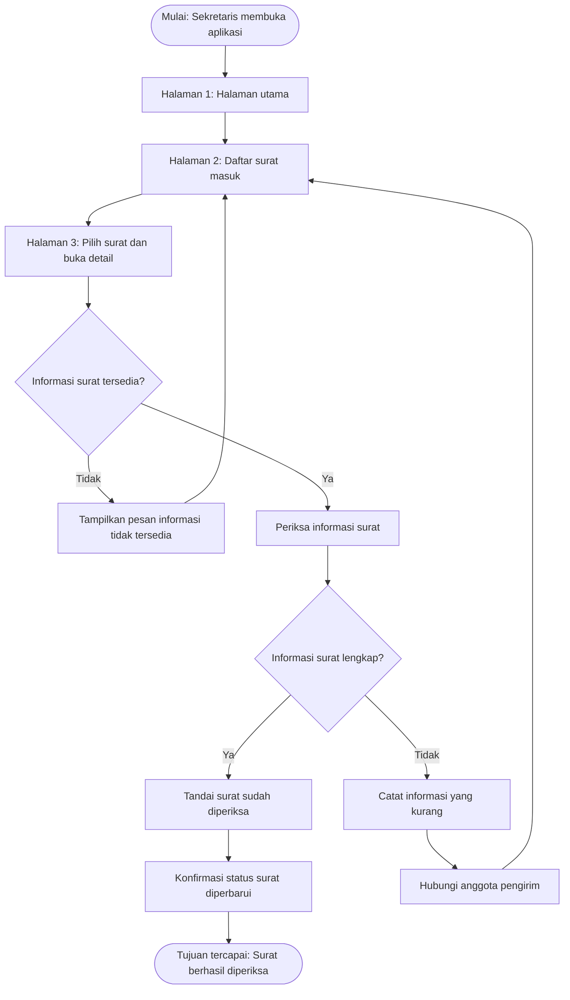

# Dokumen Kebutuhan — Pengelolaan Surat Masuk UKM

## 1. Deskripsi Aplikasi

Aplikasi Pengelolaan Surat Masuk UKM merupakan aplikasi mobile yang dirancang untuk membantu anggota, pengurus, dan sekretaris UKM dalam mencatat serta mengelola informasi surat masuk. Permasalahan yang dihadapi adalah informasi surat dapat diterima oleh anggota yang berbeda dan terkadang hanya dibagikan melalui grup WhatsApp, sehingga pencatatan dan pencarian surat menjadi kurang teratur. Aplikasi mobile dipilih agar pengguna dapat mengakses informasi surat melalui smartphone ketika menjalankan kegiatan UKM, tanpa harus selalu menggunakan komputer.

## 2. User Persona

### Persona 1 — Raka — Anggota/Pengurus UKM

| **Komponen** | **Isi** |
|---|---|
| Nama dan peran | Raka — Anggota/Pengurus UKM yang menerima atau menyampaikan informasi surat. |
| Tujuan | Menyampaikan informasi surat yang diterima agar dapat dicatat dan diketahui oleh sekretaris UKM. |
| Kendala | Informasi surat dapat diterima melalui jalur berbeda, seperti surat langsung atau grup WhatsApp, sehingga berisiko sulit ditemukan kembali. |
| Perangkat dan konteks | Menggunakan smartphone ketika menerima surat atau menjalankan kegiatan UKM. |
| Frekuensi penggunaan | Setiap kali menerima surat atau perlu menyampaikan informasi surat kepada sekretaris. |

### Persona 2 — Nadia — Sekretaris UKM

| **Komponen** | **Isi** |
|---|---|
| Nama dan peran | Nadia — Sekretaris UKM yang bertanggung jawab mengelola pencatatan surat masuk. |
| Tujuan | Melihat daftar surat, memeriksa kelengkapan informasi, dan menemukan kembali catatan surat ketika diperlukan. |
| Kendala | Informasi surat dapat tersebar di beberapa grup atau diterima oleh anggota yang berbeda sehingga pencatatan dan pencarian menjadi sulit. |
| Perangkat dan konteks | Menggunakan smartphone ketika menjalankan tugas kesekretariatan atau mengikuti kegiatan UKM. |
| Frekuensi penggunaan | Setiap kali ada surat masuk serta ketika perlu memeriksa atau mencari informasi surat. |

## 3. Kebutuhan Fungsional

| **ID** | **Rumusan Kebutuhan** | **Terkait Persona** |
|---|---|---|
| F-01 | Anggota/Pengurus UKM dapat mencatat informasi surat masuk agar surat dapat didata dalam aplikasi. | Persona 1 |
| F-02 | Anggota/Pengurus UKM dapat mengisi informasi pengirim surat agar asal surat diketahui. | Persona 1 |
| F-03 | Sekretaris UKM dapat melihat daftar surat masuk yang telah tercatat. | Persona 2 |
| F-04 | Sekretaris UKM dapat melihat detail surat yang dipilih agar informasi surat dapat diperiksa. | Persona 2 |
| F-05 | Sekretaris UKM dapat mencari surat berdasarkan kata kunci agar surat yang dibutuhkan dapat ditemukan. | Persona 2 |
| F-06 | Sekretaris UKM dapat menandai surat sebagai sudah diperiksa agar status pemeriksaannya diketahui. | Persona 2 |
| F-07 | Sekretaris UKM dapat melihat status pemeriksaan surat agar dapat membedakan surat yang sudah dan belum diperiksa. | Persona 2 |
| F-08 | Anggota/Pengurus UKM dapat melihat informasi surat yang telah dicatat agar dapat memastikan informasi yang disampaikan. | Persona 1 |

## 4. Kebutuhan Nonfungsional

| **ID** | **Kategori** | **Rumusan** | **Kriteria Terukur** |
|---|---|---|---|
| NF-01 | Kegunaan | Aplikasi harus menyediakan alur yang jelas untuk melihat detail surat dari daftar surat masuk. | Pengguna dapat membuka detail surat dari daftar dalam maksimal 3 langkah setelah halaman daftar dibuka. |
| NF-02 | Kinerja | Aplikasi harus menampilkan daftar surat yang tersedia tanpa waktu tunggu yang terlalu lama. | Pada kondisi pengujian normal dengan 100 data surat yang sudah tersedia, daftar ditampilkan maksimal 3 detik. |
| NF-03 | Kompatibilitas | Tampilan aplikasi harus tetap dapat digunakan pada ukuran layar smartphone yang berbeda. | Pada pengujian layar dengan lebar 360, 390, dan 412 piksel, teks dan tombol utama tidak terpotong atau keluar dari layar. |

## 5. Prioritas Fitur (MoSCoW)

| **Prioritas** | **ID Kebutuhan** | **Alasan** |
|---|---|---|
| Must have | F-01, F-03, F-04, F-06 | Pencatatan, daftar, detail, dan status pemeriksaan merupakan fungsi utama untuk mengatasi masalah pengelolaan surat. |
| Should have | F-02, F-07 | Informasi pengirim dan tampilan status membantu sekretaris mengelola serta memeriksa surat dengan lebih teratur. |
| Could have | F-05, F-08 | Pencarian dan akses informasi bagi anggota akan meningkatkan kemudahan penggunaan, tetapi dapat dikembangkan setelah fungsi utama tersedia. |
| Won't have (saat ini) | Tidak ada kebutuhan fungsional yang ditunda secara khusus pada daftar ini. | Seluruh kebutuhan F-01 sampai F-08 masih dipertahankan dalam cakupan perancangan. Implementasinya dapat dilakukan bertahap sesuai waktu dan kemampuan proyek. |

## 6. Pemetaan Kebutuhan ke Antarmuka

| **ID Kebutuhan** | **Rumusan (ringkas)** | **Prioritas** | **Halaman yang Memenuhi** | **Widget yang Direncanakan (P3)** |
|---|---|---|---|---|
| F-01 | Mencatat informasi surat masuk | Must | Form tambah surat | `Scaffold` + `AppBar` + `Column` |
| F-02 | Mengisi informasi pengirim | Should | Form tambah surat | `Scaffold` + `Column` |
| F-03 | Melihat daftar surat masuk | Must | Halaman daftar surat | `ListView.builder` + `ListTile` |
| F-04 | Melihat detail surat | Must | Halaman detail surat | `Scaffold` + `Column` + `Card` |
| F-05 | Mencari surat berdasarkan kata kunci | Could | Halaman daftar surat | `Column` + `ListView.builder` |
| F-06 | Menandai surat sudah diperiksa | Must | Halaman detail surat | `Scaffold` + `Column` |
| F-07 | Melihat status pemeriksaan | Should | Halaman daftar surat | `ListView.builder` + `ListTile` |
| F-08 | Melihat informasi surat yang dicatat | Could | Halaman detail surat | `Scaffold` + `Card` + `Column` |

## 7. User Flow

### 7.1 Identitas Alur

| **Aspek** | **Isi** |
|---|---|
| Nama alur | Memeriksa surat masuk |
| Aktor | Nadia — Sekretaris UKM |
| Tujuan alur | Sekretaris berhasil memeriksa informasi surat masuk dan memperbarui status pemeriksaannya. |

### 7.2 Diagram User Flow

### 7.3 Daftar Langkah

| **No.** | **Jenis** | **Langkah/Halaman** | **Bila gagal** |
|---|---|---|---|
| 1 | Mulai | Sekretaris membuka aplikasi. | — |
| 2 | Halaman | Sekretaris melihat halaman utama. | Jika halaman tidak tampil, coba buka kembali aplikasi. |
| 3 | Halaman | Sekretaris membuka daftar surat masuk. | Jika daftar tidak tampil, kembali ke halaman utama dan coba lagi. |
| 4 | Halaman | Sekretaris memilih surat dan membuka detailnya. | Jika detail tidak tersedia, kembali ke daftar surat. |
| 5 | Keputusan | Apakah informasi surat tersedia? | Jika tidak, tampilkan pesan dan kembali ke daftar surat. |
| 6 | Proses | Sekretaris memeriksa informasi surat. | Jika informasi tidak dapat dibaca, periksa kembali detail surat. |
| 7 | Keputusan | Apakah informasi surat lengkap? | Jika tidak, catat informasi yang kurang dan hubungi anggota pengirim, lalu kembali ke daftar surat. |
| 8 | Proses | Sekretaris menandai surat sebagai sudah diperiksa. | Jika status gagal diperbarui, tampilkan pesan dan coba kembali. |
| 9 | Proses | Aplikasi menampilkan status surat yang diperbarui. | Jika status belum berubah, periksa kembali status surat. |
| 10 | Selesai | Surat berhasil diperiksa dan statusnya diperbarui. | — |

### 7.4 Pemeriksaan User Flow

- Alur menggambarkan satu tujuan pengguna, yaitu memeriksa surat masuk.
- Terdapat lebih dari 8 langkah di luar titik mulai dan tujuan.
- Terdapat 2 titik keputusan.
- Setiap keputusan memiliki cabang Ya dan Tidak yang ditindaklanjuti.
- Setiap proses mengarah ke langkah berikutnya atau kembali ke proses yang sesuai.
- Diagram perlu diuji dengan meminta satu teman sekelas menelusuri alur tanpa penjelasan lisan.

## 8. Deklarasi Penggunaan AI

Deklarasi penggunaan AI: ChatGPT — membantu menyusun alternatif rumusan kebutuhan, prioritas fitur, pemetaan kebutuhan ke antarmuka, dan rancangan user flow; hasilnya ditinjau dan dirumuskan ulang oleh penulis.