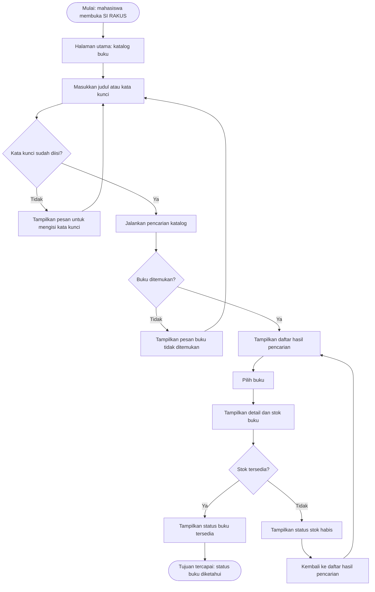

# Tugas 4 — Dokumen Kebutuhan dan User Flow

## Identitas

| Keterangan | Data |
|---|---|
| Nama | Wendi Feriyanda |
| NIM | 230660221026 |
| Program Studi | Sistem Informasi |
| Mata Kuliah | Pemrograman Aplikasi Bergerak |
| Nama aplikasi | SI RAKUS (Sistem Rak Kampus) |
| Domain | Perpustakaan kampus |

## 1. Deskripsi Aplikasi

SI RAKUS (Sistem Rak Kampus) merupakan rancangan aplikasi mobile pada domain perpustakaan kampus yang berfokus pada kebutuhan mahasiswa saat mencari informasi koleksi buku. Berdasarkan laporan audit perpustakaan Universitas Sebelas April yang tersedia, sistem Libsys telah digunakan untuk mendukung pencarian koleksi dan kegiatan operasional perpustakaan, sehingga SI RAKUS pada tugas ini diposisikan sebagai rancangan antarmuka mobile yang berorientasi pada kebutuhan mahasiswa, bukan sebagai pengganti Libsys. Melalui rancangan ini, mahasiswa direncanakan dapat mencari buku, melihat detail dan ketersediaan koleksi, serta memeriksa informasi peminjaman melalui ponsel. Aplikasi mobile dipilih karena informasi dapat diakses dari berbagai lokasi dan interaksi sentuh mendukung pencarian informasi dalam sesi singkat. Kebutuhan dan manfaat tambahannya tetap perlu dikonfirmasi terhadap fitur Libsys yang benar-benar tersedia bagi mahasiswa.

## 2. User Persona

Persona berikut merupakan gambaran awal berdasarkan peran pengguna, bukan hasil wawancara. Kendala dan frekuensi penggunaan perlu disesuaikan jika ada informasi langsung dari mahasiswa atau petugas perpustakaan.

### Persona 1 — Rani — Mahasiswa

| Komponen | Isi |
|---|---|
| Nama dan peran | Rani — mahasiswa pengguna perpustakaan |
| Tujuan | Menemukan buku yang dibutuhkan untuk kuliah dan mengetahui ketersediaannya sebelum datang ke perpustakaan. |
| Kendala | Belum tentu mengetahui ketersediaan buku sebelum mencari informasi di katalog atau bertanya kepada petugas. |
| Perangkat dan konteks | Ponsel; digunakan saat berada di kampus atau di luar kampus ketika membutuhkan referensi. |
| Frekuensi penggunaan | Diperkirakan beberapa kali dalam sebulan saat ada kebutuhan tugas atau referensi kuliah; angka ini masih asumsi dan perlu dikonfirmasi kepada pengguna. |

### Persona 2 — Dedi — Petugas Perpustakaan

| Komponen | Isi |
|---|---|
| Nama dan peran | Dedi — petugas perpustakaan |
| Tujuan | Menjaga data koleksi dan transaksi peminjaman sesuai dengan informasi yang dikelola perpustakaan. |
| Kendala | Perubahan stok dan transaksi perlu dicatat dengan benar agar informasi katalog tidak keliru. |
| Perangkat dan konteks | Komputer kerja atau perangkat yang digunakan untuk mengelola informasi perpustakaan. |
| Frekuensi penggunaan | Diperkirakan digunakan pada setiap hari operasional saat mengelola koleksi atau transaksi; kebiasaan sebenarnya perlu dikonfirmasi kepada petugas. |

## 3. Kebutuhan Fungsional

Daftar berikut merupakan kebutuhan yang diusulkan untuk rancangan SI RAKUS. Setiap kebutuhan perlu dapat diperiksa melalui pengujian, dan perlu dibandingkan dengan fitur Libsys yang telah tersedia agar tidak membuat fungsi duplikat tanpa alasan.

| ID | Rumusan Kebutuhan | Terkait Persona | Cara Verifikasi |
|---|---|---|---|
| F-01 | Mahasiswa dapat melihat daftar buku yang tercatat dalam katalog perpustakaan. | Persona 1 | Buka halaman katalog dan periksa apakah daftar buku ditampilkan. |
| F-02 | Mahasiswa dapat mencari buku berdasarkan judul atau kata kunci. | Persona 1 | Masukkan kata kunci yang cocok dengan data uji dan periksa hasil pencarian. |
| F-03 | Mahasiswa dapat melihat detail dari buku yang dipilih. | Persona 1 | Pilih salah satu hasil dan periksa apakah detail buku ditampilkan. |
| F-04 | Mahasiswa dapat melihat jumlah stok atau status ketersediaan buku. | Persona 1 | Buka detail atau hasil buku dan periksa apakah status/ stok ditampilkan sesuai data uji. |
| F-05 | Mahasiswa dapat melihat daftar peminjaman yang masih berlangsung atas namanya. | Persona 1 | Setelah identitas terverifikasi, periksa apakah daftar peminjaman milik akun tersebut ditampilkan. |
| F-06 | Mahasiswa dapat melihat riwayat peminjaman buku miliknya. | Persona 1 | Setelah identitas terverifikasi, periksa apakah riwayat yang ditampilkan sesuai akun yang masuk. |
| F-07 | Petugas dapat memperbarui data koleksi buku agar katalog sesuai dengan data yang dikelola. | Persona 2 | Petugas memperbarui data buku melalui sistem pengelolaan; periksa apakah perubahan tersimpan. Fitur pengelolaan petugas di luar lingkup antarmuka mobile mahasiswa. |
| F-08 | Mahasiswa dapat menyaring daftar buku berdasarkan kategori untuk mempersempit hasil pencarian. | Persona 1 | Pilih salah satu kategori dan periksa apakah daftar yang tampil sesuai kategori tersebut. |
| F-09 | Mahasiswa dapat masuk menggunakan akun perpustakaan yang valid agar sistem mengenali identitasnya. | Persona 1 | Masukkan akun uji yang valid dan tidak valid; periksa apakah akses diberikan atau ditolak sesuai hasil verifikasi. |

## 4. Kebutuhan Nonfungsional

Target di bawah merupakan kriteria rancangan yang harus diuji, bukan hasil pengukuran aplikasi yang sudah selesai.

| ID | Kategori | Rumusan | Kriteria Terukur |
|---|---|---|---|
| NF-01 | Kinerja | Aplikasi menampilkan hasil pencarian buku dalam waktu yang dapat diterima. | Pada pengujian dengan 500 data buku contoh dan jaringan stabil, hasil pencarian ditargetkan tampil maksimal 3 detik. |
| NF-02 | Kegunaan | Mahasiswa dapat mencapai informasi ketersediaan buku melalui alur yang ringkas. | Dari halaman katalog, pengguna ditargetkan mencapai status buku dalam maksimal 4 tindakan utama: memasukkan kata kunci, menjalankan pencarian, memilih buku, dan melihat statusnya. |
| NF-03 | Keamanan | Informasi peminjaman pribadi hanya dapat diakses oleh mahasiswa yang identitasnya sudah terverifikasi. | Akses ke halaman peminjaman dan riwayat ditolak ketika pengguna belum masuk atau menggunakan akun yang tidak sesuai. |

## 5. Prioritas Fitur (MoSCoW)

Setiap kebutuhan fungsional diberi prioritas. Kategori *Must have* dibatasi maksimal lima fitur agar ruang lingkup awal tetap realistis.

| Prioritas | ID Kebutuhan | Alasan |
|---|---|---|
| Must have | F-01, F-02, F-03, F-04 | Keempat fitur ini langsung mendukung tujuan utama mahasiswa: melihat katalog, menemukan buku, memahami detail, dan mengetahui ketersediaannya. |
| Should have | F-05, F-06, F-09 | Informasi peminjaman pribadi perlu dijaga aksesnya. Fitur ini dapat dikembangkan setelah katalog utama, dengan syarat mekanisme akun dan akses data Libsys sudah dipastikan. |
| Could have | F-08 | Filter kategori dapat membantu pencarian, tetapi mahasiswa masih dapat mencari berdasarkan judul atau kata kunci tanpa fitur ini. |
| Won't have (saat ini) | F-07 | Pengelolaan data koleksi oleh petugas tidak dibuat ulang dalam antarmuka mobile mahasiswa karena berada pada sisi pengelolaan sistem perpustakaan. Hal ini bukan berarti pengelolaan koleksi tidak diperlukan; fitur tersebut berada di luar ruang lingkup aplikasi mobile yang dianalisis. |

## 6. Pemetaan Kebutuhan ke Antarmuka

Widget di bawah adalah rencana awal berdasarkan materi Pertemuan 3, bukan desain final. Rancangan dapat diperbaiki lagi pada tahap UI/UX.

| ID Kebutuhan | Rumusan (ringkas) | Prioritas | Halaman yang Memenuhi | Widget yang Direncanakan |
|---|---|---|---|---|
| F-01 | Melihat daftar buku | Must have | Katalog buku | `Scaffold`, `AppBar`, `ListView.builder`, `ListTile` |
| F-02 | Mencari buku berdasarkan judul/kata kunci | Must have | Katalog buku | `Scaffold`, `Column`, kolom pencarian, `ListView.builder` |
| F-03 | Melihat detail buku | Must have | Detail buku | `Scaffold`, `AppBar`, `Card`, `Column`, `Text` |
| F-04 | Melihat stok/status ketersediaan | Must have | Katalog dan detail buku | `Row`, `Text`, `Card` |
| F-05 | Melihat peminjaman aktif milik sendiri | Should have | Peminjaman Saya | `Scaffold`, `ListView.builder`, `ListTile` |
| F-06 | Melihat riwayat peminjaman sendiri | Should have | Riwayat Peminjaman | `Scaffold`, `ListView.builder`, `Card`, `Text` |
| F-07 | Petugas memperbarui data koleksi | Won't have (saat ini) | Di luar antarmuka mobile mahasiswa; tetap ditangani melalui sistem pengelolaan perpustakaan | Tidak dirancang sebagai halaman petugas pada aplikasi mobile mahasiswa |
| F-08 | Menyaring buku berdasarkan kategori | Could have | Katalog buku | `Row`, pilihan kategori, `ListView.builder` |
| F-09 | Masuk menggunakan akun valid | Should have | Halaman masuk/verifikasi akun | `Scaffold`, `Form`, `TextFormField`, `ElevatedButton` |

## 7. User Flow

### 7.1 Identitas Alur

| Aspek | Isi |
|---|---|
| Nama alur | Mencari buku dan memeriksa ketersediaan |
| Aktor | Mahasiswa |
| Tujuan alur | Mahasiswa mengetahui apakah buku yang dicari tersedia |

Alur ini berfokus pada pencarian katalog yang dapat diakses mahasiswa. Akses peminjaman pribadi dan riwayat merupakan alur terpisah karena memerlukan verifikasi identitas.

### 7.2 Diagram User Flow

Simpan kode berikut sebagai `user-flow.mmd`. File sumber harus berisi sintaks Mermaid ini saja, bukan CSS atau kode hasil tampilan diagram.

### 7.3 Daftar Langkah

| No. | Jenis | Langkah/Halaman | Bila gagal |
|---:|---|---|---|
| 1 | Mulai | Mahasiswa membuka SI RAKUS. | — |
| 2 | Halaman | Halaman utama menampilkan katalog buku. | — |
| 3 | Input | Mahasiswa memasukkan judul atau kata kunci. | — |
| 4 | Keputusan | Apakah kata kunci sudah diisi? | Jika tidak, tampilkan pesan dan kembali ke input kata kunci. |
| 5 | Proses | Sistem menjalankan pencarian katalog. | — |
| 6 | Keputusan | Apakah buku ditemukan? | Jika tidak, tampilkan pesan dan izinkan mahasiswa mengganti kata kunci. |
| 7 | Halaman | Sistem menampilkan daftar hasil pencarian. | — |
| 8 | Aksi | Mahasiswa memilih buku yang ingin dilihat. | — |
| 9 | Halaman | Sistem menampilkan detail dan stok buku. | — |
| 10 | Keputusan | Apakah stok buku tersedia? | Jika tidak, tampilkan status habis dan kembalikan mahasiswa ke hasil pencarian. |
| 11 | Hasil | Sistem menampilkan bahwa buku tersedia. | — |
| 12 | Tujuan | Mahasiswa mengetahui status ketersediaan buku. | — |

Diagram memuat lebih dari delapan langkah proses di luar titik mulai dan tujuan, tiga titik keputusan, serta tindak lanjut untuk setiap cabang gagal. Tabel di atas merangkum alur utama dan tindakan saat terjadi kegagalan. Diagram tetap perlu ditelusuri oleh seorang teman sekelas sebelum dikumpulkan.

## 8. Daftar Pemeriksaan Sebelum Mengumpulkan

- [x] Deskripsi aplikasi menjelaskan nama, konteks perpustakaan, masalah/kebutuhan pengguna, dan alasan penggunaan mobile.
- [x] Minimal dua persona dengan dua peran berbeda dan kelima komponen persona.
- [x] Minimal enam kebutuhan fungsional, bernomor, satu fungsi per pernyataan, dan memiliki cara verifikasi.
- [x] Minimal dua kebutuhan nonfungsional dengan kriteria terukur.
- [x] Semua kebutuhan fungsional diberi prioritas MoSCoW dan Must have tidak lebih dari lima.
- [x] User flow memiliki lebih dari delapan langkah dan minimal dua keputusan dengan cabang gagal.
- [x] Tabel daftar langkah user flow sudah disertakan.
- [x] Setiap kebutuhan fungsional dipetakan ke halaman dan widget atau dinyatakan di luar lingkup antarmuka mobile.
- [x] Kode sumber `user-flow.mmd` hanya memuat sintaks Mermaid.
- [x] File `user-flow.png` disertakan dalam paket pengumpulan.
- [x] User flow sudah ditelusuri oleh teman sekelas tanpa penjelasan lisan; catat masukan dan lakukan perbaikan bila diperlukan.
- [x] Target kinerja dan kegunaan NF-01/NF-02 telah diperiksa kembali agar sesuai dengan kemampuan dan ruang lingkup proyek.

## Catatan Referensi Konteks

Laporan Akhir Project Audit Sistem Informasi Kelompok 1 (2026), *Pengukuran Kinerja Tata Kelola Teknologi Informasi Menggunakan Framework COBIT 2019 (Studi Kasus: Sistem E-Library (Libsys) Perpustakaan Universitas Sebelas April)*. Laporan tersebut digunakan sebagai konteks awal bahwa Libsys telah mendukung pencarian koleksi dan operasional perpustakaan. Kondisi antarmuka serta kebutuhan mahasiswa tetap perlu dikonfirmasi lebih lanjut.
