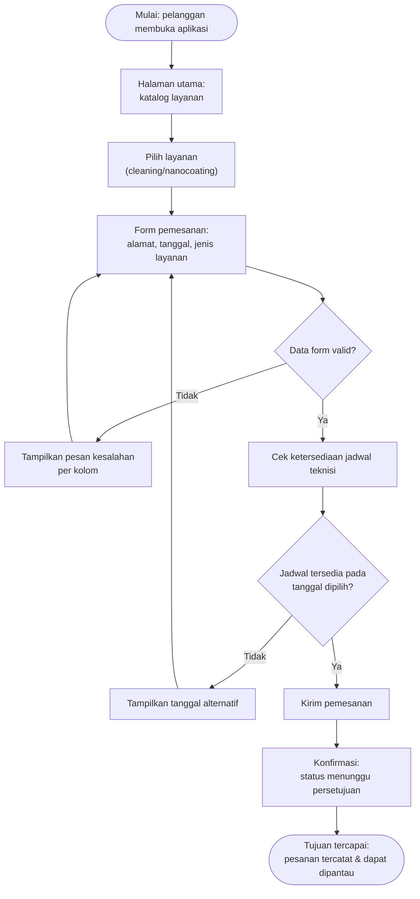

# Dokumen Kebutuhan — Glazent.pro

| | |
|:--|:--|
| **Nama** | Fajar |
| **NIM** | 230660221093 |
| **Kelas** | SI-VIIA |
| **Domain** | Usaha mikro jasa — Glazent.pro (glass cleaning & nanocoating) |

---

## 1. Deskripsi Aplikasi

**Glazent.pro — Pemesanan & Pelacakan Layanan** adalah aplikasi mobile untuk usaha jasa glass cleaning dan nanocoating Glazent.pro, yang permintaannya tumbuh cepat lewat branding Instagram tetapi masih dijalankan tanpa sistem informasi apa pun, sehingga pemesanan, penjadwalan teknisi, dan riwayat garansi belum tercatat secara sistematis dan pelanggan tidak dapat memantau status pesanannya sendiri. Solusi berbentuk aplikasi mobile dipilih karena pelanggan datang dari media sosial di ponsel dan memesan dalam sesi penggunaan singkat di sela aktivitas, sementara teknisi bekerja berpindah-pindah lokasi pekerjaan (konteks bergerak) sehingga membutuhkan jadwal dan kamera langsung di ponsel saat berada di lapangan — kedua kebutuhan ini sulit dipenuhi oleh sistem berbasis web desktop atau pencatatan manual yang selama ini dipakai.

## 2. User Persona

### Persona 1 — Rani — Pelanggan

| Komponen | Isi |
|:---------|:----|
| Nama dan peran | Rani — pelanggan rumah tangga |
| Tujuan | Memesan layanan cleaning/nanocoating kaca rumah tanpa harus menghubungi admin secara manual, dan mengetahui status pesanannya |
| Kendala | Hanya sempat mengurus pemesanan di sela waktu kerja; sinyal di rumah kadang lemah |
| Perangkat dan konteks | Ponsel pribadi, dipakai sebentar-sebentar kapan saja saat teringat atau ada kebutuhan |
| Frekuensi penggunaan | Jarang — beberapa kali dalam setahun, kecuali saat ada masalah kaca mendadak |

### Persona 2 — Dimas — Teknisi Lapangan

| Komponen | Isi |
|:---------|:----|
| Nama dan peran | Dimas — teknisi lapangan |
| Tujuan | Mengetahui jadwal dan alamat kerja hari ini tanpa harus dihubungi satu per satu, dan mencatat bukti hasil pekerjaan |
| Kendala | Berpindah-pindah lokasi kerja (rumah, gedung, cluster); sinyal di lokasi kerja kadang tidak stabil |
| Perangkat dan konteks | Ponsel kerja, dipakai sepanjang jam kerja di lokasi pelanggan |
| Frekuensi penggunaan | Setiap hari kerja |

## 3. Kebutuhan Fungsional

| ID | Rumusan Kebutuhan | Terkait Persona |
|:---|:------------------|:----------------|
| F-01 | Pelanggan dapat memesan layanan dengan mengisi jenis layanan, alamat, dan tanggal yang diinginkan sehingga pesanan tersimpan dan muncul di daftar pesanan | Persona 1 |
| F-02 | Pelanggan dapat melihat status pesanan terkini (menunggu persetujuan, dijadwalkan, selesai) pada halaman status pesanan | Persona 1 |
| F-03 | Pelanggan dapat melihat riwayat pekerjaan beserta tanggal pengerjaan dan sisa masa berlaku garansi nanocoating | Persona 1 |
| F-04 | Teknisi dapat melihat daftar tugas harian beserta alamat dan waktu kunjungan yang ditugaskan | Persona 2 |
| F-05 | Teknisi dapat mengunggah foto kondisi kaca sebelum dan sesudah pengerjaan sebagai bukti hasil kerja | Persona 2 |
| F-06 | Teknisi dapat menandai status pekerjaan menjadi selesai setelah pengerjaan di lokasi rampung | Persona 2 |
| F-07 | Pelanggan dapat mencari layanan berdasarkan kategori (rumah tangga, korporat, kendaraan) pada halaman katalog | Persona 1 |
| F-08 | Pelanggan dapat menerima notifikasi pengingat jadwal kunjungan teknisi sebelum waktu pengerjaan | Persona 1 |

## 4. Kebutuhan Nonfungsional

| ID | Kategori | Rumusan | Kriteria Terukur |
|:---|:---------|:--------|:-----------------|
| NF-01 | Kegunaan | Alur pemesanan layanan oleh pelanggan harus dapat diselesaikan dengan cepat agar sesuai pola penggunaan sesi singkat | Pemesanan selesai maksimal 5 langkah sentuhan dari halaman utama |
| NF-02 | Kinerja | Daftar tugas harian teknisi harus tetap dapat dibuka meski sinyal di lokasi kerja lemah | Daftar tugas tampil kurang dari 3 detik pada jaringan normal, dan tetap terbaca dari cache saat offline |
| NF-03 | Keamanan | Data pesanan dan riwayat pelanggan tidak boleh terlihat oleh pelanggan lain | Riwayat pesanan hanya dapat diakses oleh pemilik akun pelanggan yang bersangkutan dan pemilik usaha |

## 5. Prioritas Fitur (MoSCoW)

| Prioritas | ID Kebutuhan | Alasan |
|:----------|:-------------|:-------|
| Must have | F-01, F-02, F-04, F-05, F-06 | Kelima kebutuhan ini membentuk alur inti kedua persona: pelanggan memesan dan memantau status, teknisi mengetahui tugas dan mencatat bukti kerja — tanpa ini aplikasi belum menyelesaikan masalah utama di latar belakang (belum ada sistem pemesanan dan pencatatan sama sekali) |
| Should have | F-03 | Riwayat dan garansi penting bagi kepercayaan pelanggan, tetapi untuk saat ini masih bisa dicek manual oleh pemilik sembari fitur inti pemesanan dan penugasan berjalan lebih dulu |
| Could have | F-07 | Pencarian berdasarkan kategori menambah kenyamanan, tetapi dengan jumlah layanan Glazent.pro yang masih sedikit, daftar tanpa pencarian pun masih dapat ditelusuri manual oleh Rani |
| Won't have (saat ini) | F-08 | Notifikasi push membutuhkan infrastruktur tambahan yang belum sempat dibangun pada MVP semester ini; sebagai gantinya pelanggan tetap bisa mengecek status secara manual melalui F-02 |

## 6. User Flow

**Alur utama:** Rani (Persona 1) memesan layanan dari halaman utama hingga pesanan tercatat dan dapat dipantau.

File sumber: [`user-flow.mmd`](user-flow.mmd) (Mermaid).

### Daftar Langkah

| No. | Jenis | Langkah/Halaman | Bila gagal |
|:---:|:------|:--------------|:-----------|
| 1 | Mulai | Pelanggan membuka aplikasi | — |
| 2 | Halaman | Halaman utama: katalog layanan | — |
| 3 | Halaman | Pilih layanan (cleaning/nanocoating) | — |
| 4 | Halaman | Form pemesanan: alamat, tanggal, jenis layanan | — |
| 5 | Keputusan | Data form valid? | Tampilkan pesan kesalahan per kolom, kembali ke form |
| 6 | Proses | Cek ketersediaan jadwal teknisi | — |
| 7 | Keputusan | Jadwal tersedia pada tanggal dipilih? | Tampilkan tanggal alternatif, kembali ke form |
| 8 | Proses | Kirim pemesanan | — |
| 9 | Proses | Konfirmasi: status menunggu persetujuan | — |
| 10 | Tujuan | Pesanan tercatat & dapat dipantau | — |

## 7. Pemetaan Kebutuhan ke Antarmuka

| ID Kebutuhan | Rumusan (ringkas) | Prioritas | Halaman yang Memenuhi | Widget yang Direncanakan (P3) |
|:-------------|:------------------|:----------|:----------------------------|:------------------------------|
| F-01 | Memesan layanan (jenis, alamat, tanggal) | Must | Halaman form pemesanan | `Scaffold` + `Column` (form) |
| F-02 | Melihat status pesanan terkini | Must | Halaman status pesanan saya | `ListView.builder` + `Text` status berwarna (ternary) |
| F-03 | Melihat riwayat pekerjaan & garansi | Should | Halaman riwayat & garansi | `ListView.builder` + `Card` |
| F-04 | Melihat daftar tugas harian teknisi | Must | Halaman tugas harian (teknisi) | `ListView.builder` + `ListTile` |
| F-05 | Mengunggah foto bukti sebelum/sesudah | Must | Halaman detail tugas | `Scaffold` + `Column` (tombol kamera, detail minggu 11) |
| F-06 | Menandai pekerjaan selesai | Must | Halaman detail tugas | `Scaffold` + `Column` + tombol aksi |
| F-07 | Mencari layanan berdasarkan kategori | Could | Halaman utama + kolom pencarian | `ListView.builder` + `where` (P2) |

Catatan: F-08 (Won't have) belum memiliki halaman karena ditunda pada semester ini.

---

## Deklarasi Penggunaan AI

Deklarasi penggunaan AI: Claude (Anthropic) — membantu menyusun kerangka awal persona, rumusan kebutuhan fungsional/nonfungsional, prioritas MoSCoW, diagram user flow, dan tabel pemetaan berdasarkan domain Glazent.pro yang sudah ditentukan penulis sejak Tugas 1; hasilnya dirumuskan ulang oleh penulis.
