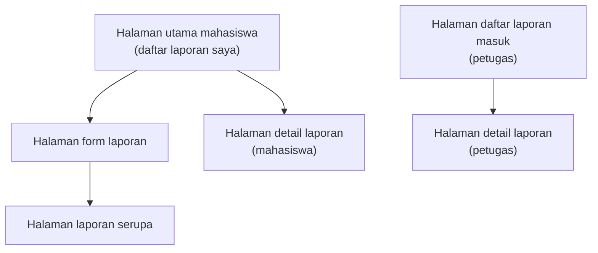

# Information Architecture: SiLapor Kampus

Nama layar dan ID kebutuhan di bawah ini diambil dari tabel pemetaan kebutuhan ke antarmuka pada Tugas 4 (Bagian 6).

## 1. Inventaris Layar

| No | Layar | Pengguna | Kebutuhan yang dipenuhi | Prioritas |
|:--:|:------|:---------|:------------------------|:----------|
| 1 | Halaman utama mahasiswa (daftar laporan saya) | Dina | F-03 melihat status laporan; F-07 mencari laporan | Must, Should |
| 2 | Halaman form laporan | Dina | F-01 membuat laporan; F-02 melampirkan foto | Must, Should |
| 3 | Halaman laporan serupa | Dina | F-04 melihat laporan serupa sebelum kirim | Must |
| 4 | Halaman detail laporan (mahasiswa) | Dina | F-08 membatalkan laporan Menunggu | Could |
| 5 | Halaman daftar laporan masuk (petugas) | Pak Asep | F-05 melihat daftar laporan masuk; F-09 menyaring menurut kategori | Must, Could |
| 6 | Halaman detail laporan (petugas) | Pak Asep | F-06 mengubah status dan mencatat penanganan | Must |

F-10 (pemberitahuan) berstatus Won't have, sehingga tidak punya layar pada IA ini.

## 2. Diagram IA

## 3. Alasan Layar Utama

Halaman utama mahasiswa dipilih karena memenuhi F-03 (Must have), kebutuhan Dina untuk mengetahui kapan laporannya ditangani, dan menjadi satu-satunya jalan masuk ke F-01 lewat tombol aksi utama. Layar petugas bukan layar utama karena prototype ini mengikuti user flow Tugas 4 yang berangkat dari Dina.
