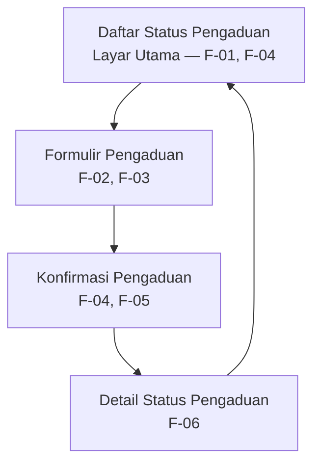

# Information Architecture — SI-FASKAM

## 1. Inventaris Layar

| No. | Nama layar | Fungsi utama | ID kebutuhan yang dipenuhi |
|---:|---|---|---|
| 1 | Daftar Status Pengaduan | Menampilkan daftar laporan mahasiswa beserta statusnya dan menyediakan aksi untuk membuat pengaduan baru. | F-01, F-04 |
| 2 | Formulir Pengaduan | Memungkinkan mahasiswa memilih kategori fasilitas, mengisi deskripsi masalah, dan mengirim pengaduan. | F-02, F-03 |
| 3 | Konfirmasi Pengaduan | Memberikan informasi bahwa pengaduan berhasil dikirim atau menampilkan pesan jika pengiriman gagal. | F-04, F-05 |
| 4 | Detail Status Pengaduan | Menampilkan informasi dan status pengaduan yang telah dikirim. | F-06 |

> **Catatan:** ID F-01 sampai F-06 di atas masih berupa penanda sementara. Sesuaikan ID dan nama layar dengan tabel pemetaan kebutuhan-ke-antarmuka pada Tugas 4 sebelum dikumpulkan.

## 2. Diagram Information Architecture

## 3. Alasan Pemilihan Layar Utama

Daftar Status Pengaduan dipilih sebagai layar utama karena membantu mahasiswa melihat laporan yang sudah dikirim dan statusnya, sekaligus menyediakan akses yang jelas untuk membuat pengaduan baru. Layar ini mendukung kebutuhan inti SI-FASKAM untuk memudahkan mahasiswa mengirim dan memantau pengaduan fasilitas kampus.