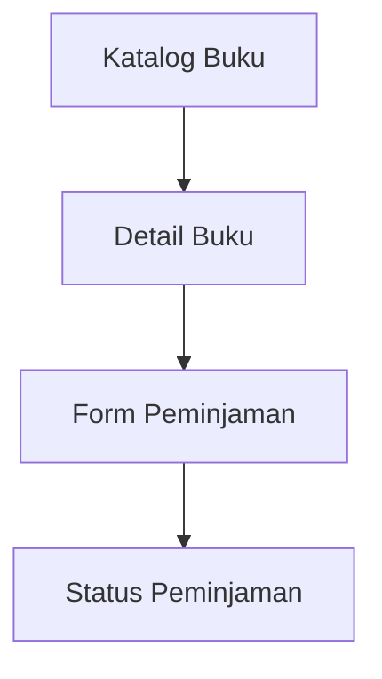

# Information Architecture — Perpustakaan Kampus

## 1. Deskripsi Aplikasi

Perpustakaan Kampus merupakan aplikasi yang membantu mahasiswa mencari informasi buku dan mengajukan peminjaman buku.

## 2. Inventaris Layar

| No. | Nama Layar | ID Kebutuhan | Fungsi |
|---|---|---|---|
| 1 | Katalog Buku | [ID dari Tugas 4] | Menampilkan daftar buku dan membantu mahasiswa mencari buku. |
| 2 | Detail Buku | [ID dari Tugas 4] | Menampilkan judul, penulis, kategori, dan status ketersediaan buku. |
| 3 | Form Peminjaman | [ID dari Tugas 4] | Membantu mahasiswa mengisi data peminjaman buku. |
| 4 | Status Peminjaman | [ID dari Tugas 4] | Menampilkan informasi status pengajuan peminjaman. |

## 3. Diagram Information Architecture

## 4. Alasan Pemilihan Layar Utama

Katalog Buku dipilih sebagai layar utama karena mahasiswa perlu melihat dan mencari buku sebelum memutuskan untuk meminjamnya. Dari layar ini, pengguna dapat membuka Detail Buku dan melanjutkan proses peminjaman apabila buku tersedia.