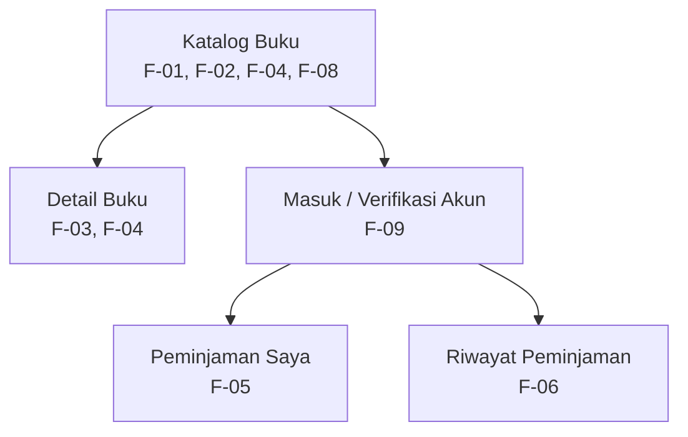

# Information Architecture — SI RAKUS

## 1. Deskripsi

SI RAKUS (Sistem Rak Kampus) merupakan rancangan aplikasi mobile yang membantu mahasiswa mencari koleksi buku perpustakaan dan mengetahui ketersediaan stoknya. Information Architecture disusun berdasarkan kebutuhan fungsional pada Tugas 4 agar struktur layar sesuai dengan fungsi yang diperlukan pengguna.

## 2. Inventaris Layar

| No. | Nama Layar | ID Kebutuhan | Fungsi |
|---|---|---|---|
| 1 | Katalog Buku | F-01, F-02, F-04, F-08 | Menampilkan daftar buku, pencarian, ketersediaan, dan filter kategori. |
| 2 | Detail Buku | F-03, F-04 | Menampilkan informasi buku dan status stok. |
| 3 | Halaman Masuk/Verifikasi Akun | F-09 | Memverifikasi identitas sebelum menampilkan informasi peminjaman pribadi. |
| 4 | Peminjaman Saya | F-05 | Menampilkan informasi peminjaman yang sedang berlangsung. |
| 5 | Riwayat Peminjaman | F-06 | Menampilkan riwayat peminjaman mahasiswa. |

**Catatan lingkup:** F-07, yaitu pengelolaan data koleksi oleh petugas, tidak dimasukkan sebagai layar aplikasi mobile mahasiswa karena fitur tersebut ditetapkan sebagai *Won't have* pada tahap ini.

**Periksa kembali:** pastikan nama layar dan pemetaan kebutuhan di atas sama dengan yang tercantum pada dokumen Tugas 4.

## 3. Diagram Information Architecture

Panah menunjukkan hubungan akses antarlayar secara konseptual. Implementasi navigasi antarlayar belum termasuk cakupan kode Tugas 5.

## 4. Alasan Pemilihan Layar Utama

Katalog Buku dipilih sebagai layar utama karena mendukung kebutuhan *Must have*, terutama F-01 untuk melihat katalog dan F-02 untuk mencari buku. Layar ini menjadi titik awal mahasiswa untuk menemukan koleksi, kemudian membuka Detail Buku untuk membaca informasi lebih lanjut dan memeriksa ketersediaan stok.

## 5. Hubungan dengan Wireframe

Wireframe Tugas 5 menampilkan dua layar, yaitu Katalog Buku sebagai layar utama dan Detail Buku sebagai layar pendukung. Kedua layar tersebut dipilih karena menggambarkan kebutuhan inti pencarian informasi buku. Layar lainnya dicantumkan dalam Information Architecture sebagai bagian dari struktur aplikasi yang direncanakan, tetapi tidak seluruhnya diimplementasikan pada Tugas 5.