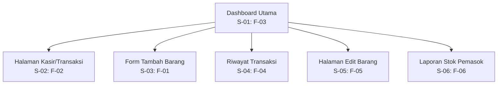

# Information Architecture — Aplikasi Mobile Pengelolaan Penjualan Warung

## 1. Inventaris Layar

| ID Layar | Nama Layar | Kebutuhan yang Dipenuhi | Prioritas | Fungsi Utama |
|---|---|---|---|---|
| S-01 | Dashboard Utama | F-03 | Must have | Menampilkan daftar barang, harga, jumlah stok, dan status stok minimum. |
| S-02 | Halaman Kasir/Transaksi | F-02 | Must have | Memungkinkan pemilik warung memilih barang, memasukkan jumlah, dan melihat total harga transaksi. |
| S-03 | Form Tambah Barang | F-01 | Must have | Memasukkan nama barang, harga, dan jumlah stok awal. |
| S-04 | Riwayat Transaksi | F-04 | Should have | Menampilkan riwayat transaksi penjualan harian. |
| S-05 | Halaman Edit Barang | F-05 | Should have | Memperbarui harga dan stok barang. |
| S-06 | Laporan Stok Pemasok | F-06 | Could have | Menampilkan rekap barang yang memerlukan pengadaan stok ulang. |

## 2. Struktur Navigasi

## 3. Alasan Pemilihan Layar Utama

Dashboard Utama dipilih sebagai layar utama karena memenuhi kebutuhan F-03 yang berprioritas Must have, yaitu melihat daftar stok barang terkini beserta status peringatan stok minimum. Informasi stok perlu terlihat dengan cepat karena pemilik warung menggunakan aplikasi sambil melayani pelanggan. Daftar barang disajikan menggunakan komponen ListTile di dalam ListView agar nama barang, harga, jumlah stok, dan statusnya mudah dipindai.

Halaman Kasir/Transaksi menjadi layar pendukung yang penting karena memenuhi F-02, yaitu pencatatan transaksi penjualan. Layar ini dirancang agar pemilik warung dapat memilih barang, menentukan jumlah, dan melihat total harga dengan alur yang ringkas, sejalan dengan kebutuhan nonfungsional NF-01 tentang penyelesaian satu transaksi maksimal dalam empat langkah interaksi layar.

## 4. Batasan Prototipe

Prototipe Tugas 5 memprioritaskan Dashboard Utama sebagai implementasi Flutter dan menampilkan Halaman Kasir/Transaksi sebagai layar pendukung pada wireframe. Layar lain dicatat dalam arsitektur informasi sebagai cakupan kebutuhan aplikasi, tetapi tidak semuanya harus diimplementasikan pada tugas ini.