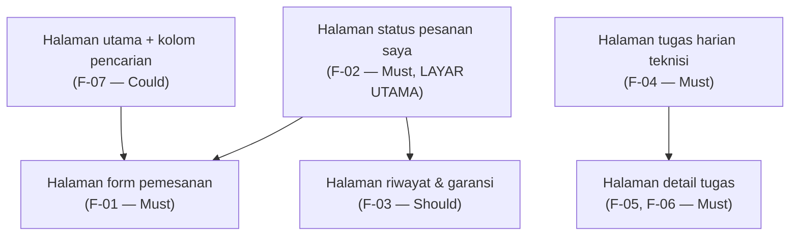

# Information Architecture — Glazent.pro

| | |
|:--|:--|
| **Nama** | Fajar |
| **NIM** | 230660221093 |
| **Kelas** | SI-VIIA |
| **Domain** | Usaha mikro jasa — Glazent.pro (glass cleaning & nanocoating) |

---

## 1. Inventaris Layar

Diambil dari tabel pemetaan kebutuhan ke antarmuka pada Tugas 4.

| Layar | ID Kebutuhan | Prioritas |
|:------|:-------------|:----------|
| Halaman status pesanan saya | F-02 | Must |
| Halaman form pemesanan | F-01 | Must |
| Halaman riwayat & garansi | F-03 | Should |
| Halaman utama + kolom pencarian | F-07 | Could |
| Halaman tugas harian (teknisi) | F-04 | Must |
| Halaman detail tugas | F-05, F-06 | Must |

## 2. Diagram IA

File sumber: [`ia.mmd`](ia.mmd) (Mermaid).

Diagram ini menunjukkan tiga kelompok layar: (1) **sisi pelanggan** yang berpusat pada halaman status pesanan, bercabang ke form pemesanan dan riwayat & garansi; (2) **katalog layanan** sebagai pintu masuk alternatif menuju form pemesanan; dan (3) **sisi teknisi** yang terpisah, dari daftar tugas harian menuju detail tugas.

## 3. Alasan Layar Utama

**Halaman status pesanan saya** dipilih sebagai layar utama karena memenuhi F-02, satu-satunya kebutuhan Must have yang sekaligus menjawab keluhan terbesar Rani (persona pelanggan) pada Tugas 4, yaitu tidak mengetahui status pesanannya. Layar ini juga menjadi titik masuk langsung menuju F-01 (mengajukan pemesanan) melalui tombol aksi utama, sehingga pelanggan tidak perlu berpindah layar terlebih dahulu untuk memesan layanan baru.
