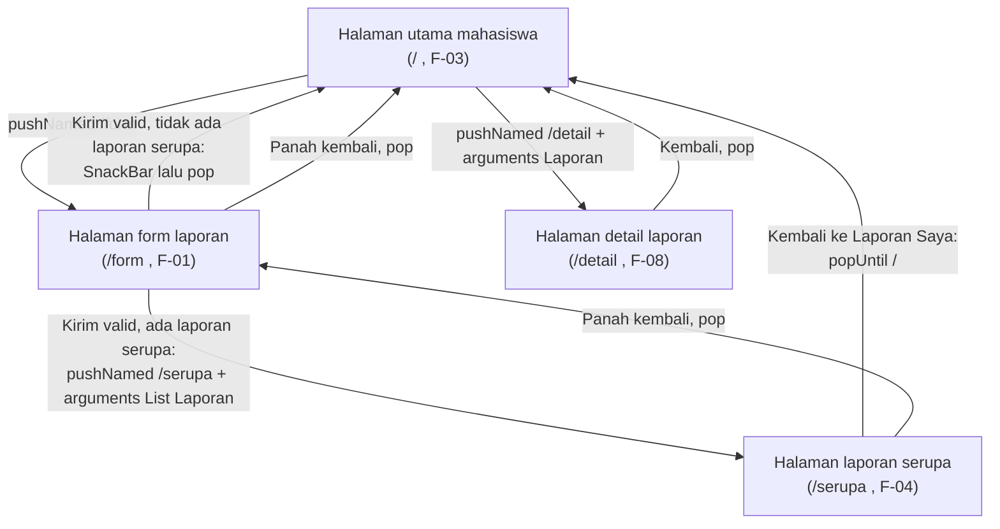

# Navigation Flow: SiLapor Kampus

Navigation flow ini menghubungkan layar mahasiswa pada IA Tugas 5 menjadi alur yang bisa dijalankan. Nama layar dan ID kebutuhan mengikuti `information-architecture.md` dan tabel pemetaan Tugas 4 (Bagian 6). Alur berangkat dari Dina, mahasiswa pelapor, sama seperti prototype Tugas 5.

## 1. Daftar Route

| Nama route | Layar (IA Tugas 5) | Dibuka dari | Data yang dikirim | Kebutuhan yang dipenuhi |
|:-----------|:-------------------|:------------|:------------------|:------------------------|
| `/` (`initialRoute`) | Halaman utama mahasiswa (daftar laporan saya) | Awal aplikasi | - | F-03 (Must), F-07 (Should) |
| `/form` | Halaman form laporan | Tombol Buat Laporan pada `/` | - (diisi pengguna) | F-01 (Must), F-02 (Should) |
| `/serupa` | Halaman laporan serupa | Tombol Kirim laporan pada `/form`, hanya bila ada laporan aktif di lokasi yang sama | `List<Laporan>` (read-only) | F-04 (Must) |
| `/detail` | Halaman detail laporan (mahasiswa) | Ketukan kartu pada `/` | Objek `Laporan` (read-only) | F-08 (Could) |

Dua layar petugas pada IA (daftar laporan masuk dan detail laporan petugas) tidak punya route, karena prototype hanya mengikuti alur Dina, sesuai alasan layar utama pada IA.

## 2. Diagram Alur

Tugas Must have yang digambarkan: membuat laporan kerusakan (F-01) beserta pengecekan laporan serupa (F-04), lalu memantau laporan (F-03). Alur ini sama dengan user flow Tugas 4 Bagian 7.

Tiga jenis perpindahan ada di diagram: maju (`pushNamed`), kembali (`pop` dan `popUntil`), dan kirim data (arguments `List<Laporan>` ke `/serupa`, `Laporan` ke `/detail`).

Pada jalur utama tanpa laporan serupa, Dina melalui halaman utama, ketuk Buat Laporan, isi form, ketuk Kirim, lalu melihat SnackBar. Itu lima langkah, di dalam batas NF-01 (maksimal 6 langkah).

## 3. Alasan `initialRoute`

`/` menjadi layar pertama karena memenuhi F-03 (Must): Dina lebih sering membuka aplikasi untuk mengecek status laporan lamanya daripada membuat laporan baru. Dari layar ini F-01 hanya berjarak satu ketukan lewat tombol aksi utama, dan IA menetapkannya sebagai satu-satunya jalan masuk ke form.