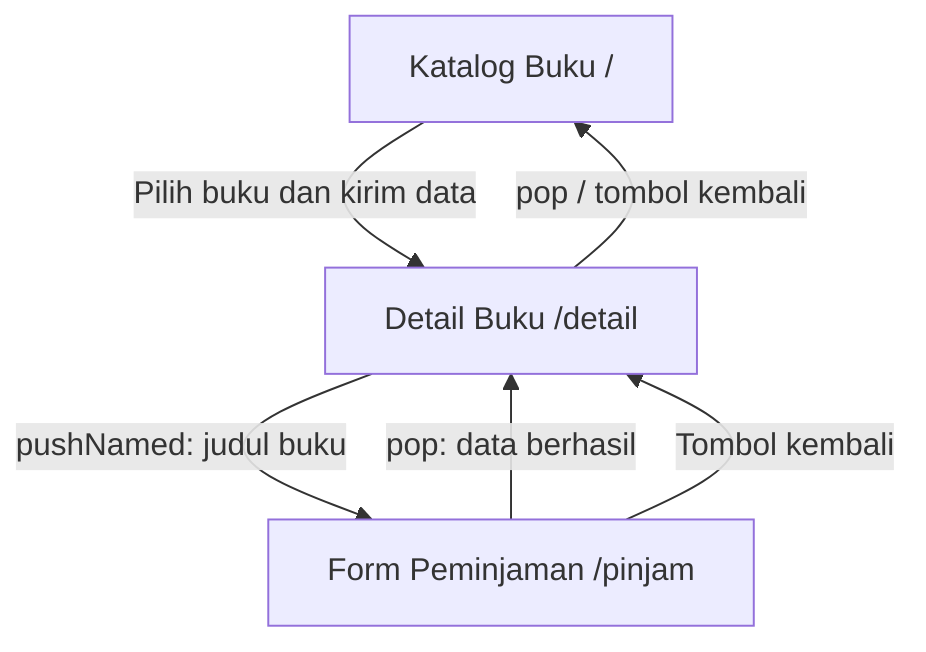

# Navigation Flow — Perpustakaan Kampus

## 1. Tabel Rute

| Nama Rute | Halaman | Fungsi |
|---|---|---|
| `/` | Katalog Buku | Menampilkan daftar buku yang tersedia dan dapat dipilih pengguna. |
| `/detail` | Detail Buku | Menampilkan informasi buku berdasarkan data yang dikirim dari katalog. |
| `/pinjam` | Form Peminjaman | Menampilkan formulir untuk mengajukan peminjaman buku. |

## 2. Diagram Alur Navigasi

## 3. Penjelasan Navigasi

1. Pengguna membuka aplikasi dan melihat halaman Katalog Buku sebagai halaman awal.
2. Ketika pengguna memilih buku, aplikasi membuka halaman Detail Buku dan mengirimkan objek data buku melalui `arguments`.
3. Pada halaman detail, aplikasi memeriksa tipe data yang diterima sebelum menampilkan informasi buku.
4. Jika buku tersedia, pengguna dapat membuka Form Peminjaman melalui `Navigator.pushNamed` dengan membawa judul buku sebagai argumen.
5. Formulir memvalidasi data sebelum pengajuan diproses. Jika valid, aplikasi menampilkan notifikasi dan kembali ke halaman sebelumnya menggunakan `Navigator.pop`.
6. Pengguna dapat kembali ke halaman sebelumnya menggunakan tombol kembali yang tersedia.

## 4. Alasan Pemilihan Initial Route

Rute awal menggunakan `/` karena pengguna perlu melihat katalog terlebih dahulu sebelum memilih buku. Alur ini sesuai dengan proses peminjaman buku di lingkungan perpustakaan kampus.