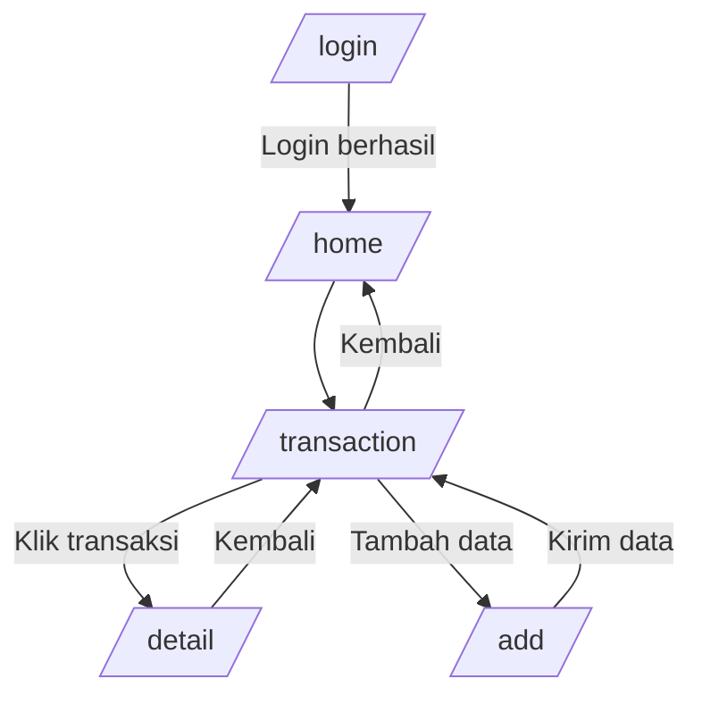

# Navigation Flow MoneyTrack

## Daftar Route

| Route | Layar | Kebutuhan | Initial Route |
|---|---|---|---|
| /login | Halaman Login | User authentication | ✓ |
| /home | Dashboard Keuangan | Melihat saldo | |
| /transaction | Daftar Transaksi | Melihat transaksi | |
| /detail | Detail Transaksi | Detail data | |
| /add | Tambah Transaksi | Input transaksi | |

Initial Route:
`/login`

Alasan:
Login menjadi halaman awal karena pengguna harus melakukan validasi akses sebelum menggunakan fitur utama aplikasi.

## Diagram Alur

