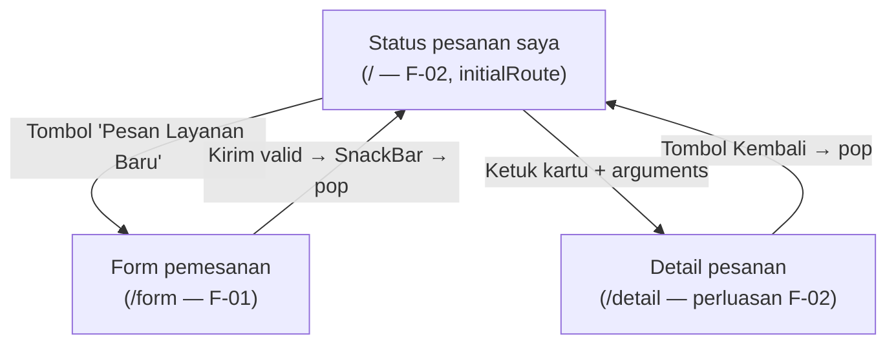

# Navigation Flow — Glazent.pro

| | |
|:--|:--|
| **Nama** | Fajar |
| **NIM** | 230660221093 |
| **Kelas** | SI-VIIA |
| **Domain** | Usaha mikro jasa — Glazent.pro (glass cleaning & nanocoating) |

---

## 1. Daftar Route

| Nama route | Layar (dari IA Tugas 5) | Kebutuhan yang Dipenuhi | `initialRoute`? |
|:-----------|:-------------------------|:--------------------------|:-----------------|
| `/` | Halaman status pesanan saya | F-02 (Must) | Ya |
| `/form` | Halaman form pemesanan | F-01 (Must) | Tidak |
| `/detail` | Detail pesanan (perluasan tampilan dari Halaman status pesanan saya) | F-02 (Must) | Tidak |

Catatan: `/detail` tidak muncul sebagai baris terpisah pada tabel pemetaan Tugas 4 maupun diagram IA Tugas 5, karena layar ini adalah perluasan tampilan dari kartu pesanan pada F-02 (pelanggan melihat detail satu pesanan, bukan kebutuhan baru) — pola yang sama dipakai pada contoh CBL materi (`demo-navigasi-flutter.dart`: daftar pengajuan dan detail pengajuan sama-sama memenuhi F-03).

## 2. Diagram Navigation Flow

**Tugas Must have yang digambarkan:** F-01 (mengajukan pemesanan) dan F-02 (melihat status pesanan, termasuk detailnya), mencakup alur maju, kembali, dan pengiriman data.

File sumber: [`navigation-flow.mmd`](navigation-flow.mmd) (Mermaid).

## 3. Alasan `initialRoute`

`/` (Halaman status pesanan saya) dipilih sebagai `initialRoute` karena memenuhi F-02, satu-satunya kebutuhan Must have yang menjadi titik keluhan terbesar Rani (persona pelanggan, Tugas 4) — tidak mengetahui status pesanannya — dan sekaligus menjadi titik masuk langsung menuju F-01 melalui tombol aksi utama, sama seperti keputusan layar utama pada Tugas 5.
